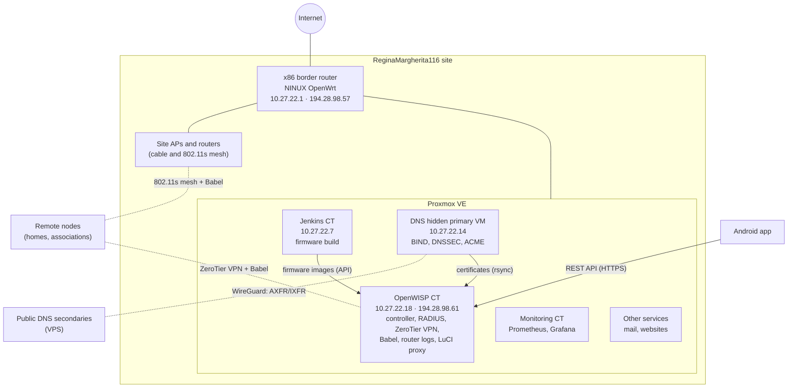

# Architecture

## Overview

- **Border router**: an x86 box with NINUX OpenWrt. It goes to the Internet and
  carries the public /29 `194.28.98.56/29`, routed through a PPTP tunnel to the
  provider. The rest of the site is on the management LAN `10.27.22.0/24`.
- **Proxmox VE**: a single host, with one container (LXC) or VM per service.
  Every service is rebuilt by an Ansible playbook.
- **OpenWISP** manages all routers: configuration, monitoring, VPN, RADIUS
  authentication of the hotspots, firmware upgrades.
- **Jenkins** builds the NINUX OpenWrt firmware and uploads it to OpenWISP.
- **DNS**: the primary is hidden in the LAN, the public secondaries receive the
  zones through a WireGuard tunnel. The same server issues the wildcard
  certificates and copies them to the containers that use them.

## The router network

| Network | Addresses | Use |
|---|---|---|
| Site management LAN | `10.27.22.0/24` | servers, APs and routers of the site |
| Node LANs | one `/24` per node inside `10.27.0.0/16` | the clients of each node |
| ZeroTier VPN | `10.27.255.0/24` (server `.1`) | connects remote nodes to the server and to each other |
| 802.11s mesh | `br-mesh`, SAE encrypted | radio links between nearby nodes |
| Hotspot | captive portal network (uspot) | free Wi-Fi with RADIUS login |

Routing between nodes is done by **Babel** (BIRD): every node announces its LAN
and learns the others. Every link has a **cost**, computed by Babel from its
`rxcost`; the **metric** of a route is the sum of the costs of the links it
crosses, and the lowest one wins.

| Link | `rxcost` | Cost |
|---|---|---|
| Cable | 96 | fixed |
| Radio (802.11s mesh) | 256 | from 256 up: it grows with packet loss (ETX) |
| ZeroTier VPN | 600 | fixed |

So **cable always beats radio**, and a **good radio link beats the VPN**; a
badly degraded radio link can cost more than 600, and then Babel goes through
the VPN. The default route never goes through Babel: every node reaches the
Internet through its own connection, and nodes without one learn it from their
mesh neighbours via OSPF.

*The "Babel NINUX" topology in OpenWISP: the site on the left (cable and
radio), the remote sites on the right, reached through the VPN.*

Details (costs, filters, topology script) are in the openwisp2 README, section
[BIRD / Babel](https://github.com/mikysal78/openwisp2/blob/main/README.en.md#babel).

## DNS names

| Name | Points to | Use |
|---|---|---|
| `openwisp.ninux-nnxx.it` | OpenWISP (`194.28.98.61`) | admin, API, router agent |
| `wifi.ninux-nnxx.it` | OpenWISP | hotspot login pages |
| `zerotier.ninux-nnxx.it` | CNAME of openwisp | ZeroTier controller reference |
| `*.luci.ninux-nnxx.it` | CNAME of openwisp | LuCI proxy, one host per router |
| `gw.ninux-nnxx.it` | border router (`194.28.98.57`) | logs and management of the border router |
| `dyn.ninux-nnxx.it` | dynamic zone | DDNS of routers with a changing IP |

## Main flows

1. **A new router** boots with the NINUX firmware, which contains the OpenWISP
   address and the organization secret. The `openwisp-config` agent registers
   by itself, receives the templates (Babel, mesh, VPN…) and joins the
   ZeroTier VPN.
2. **OpenWISP monitoring** checks every router (ping, resources, Wi-Fi
   clients, traffic) and sends notifications when something goes wrong.
3. **Router logs** (syslog and netconsole) reach the OpenWISP server and can be
   read on the device page.
4. **New firmware** is built by Jenkins, uploaded to the OpenWISP firmware
   upgrader and installed on the routers from there.
5. **Hotspot users** sign up on the Wi-Fi page (also with Google) and are
   authenticated by FreeRADIUS through OpenWISP.
