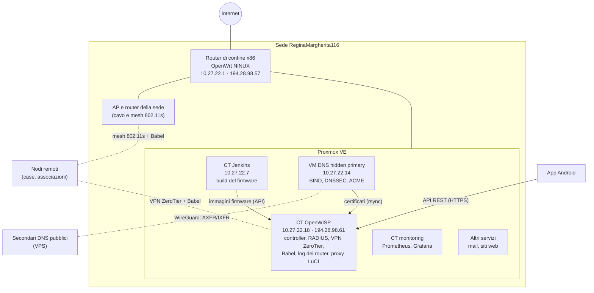

# Architettura

## Il quadro generale

- **Router di confine**: un x86 con OpenWrt NINUX. Esce su Internet e porta la
  /29 pubblica `194.28.98.56/29`, instradata in un tunnel PPTP verso il
  provider. Il resto della sede sta sulla LAN di gestione `10.27.22.0/24`.
- **Proxmox VE**: un solo host, con un container (LXC) o una VM per ogni
  servizio. Ogni servizio si ricostruisce da un playbook Ansible.
- **OpenWISP** gestisce tutti i router: configurazione, monitoraggio, VPN,
  autenticazione RADIUS degli hotspot, aggiornamento del firmware.
- **Jenkins** compila il firmware OpenWrt NINUX e lo carica in OpenWISP.
- **DNS**: il primary è nascosto in LAN, i secondari pubblici ricevono le zone
  in un tunnel WireGuard. Lo stesso server emette i certificati wildcard e li
  copia nei container che li usano.

## La rete dei router

| Rete | Indirizzi | Uso |
|---|---|---|
| LAN di gestione della sede | `10.27.22.0/24` | server, AP e router della sede |
| LAN dei nodi | una `/24` per nodo dentro `10.27.0.0/16` | i client di ogni nodo |
| VPN ZeroTier | `10.27.255.0/24` (server `.1`) | collega i nodi remoti al server e tra loro |
| Mesh 802.11s | `br-mesh`, cifrata SAE | collegamenti radio tra nodi vicini |
| Hotspot | rete del captive portal (uspot) | Wi-Fi libero con login RADIUS |

Il routing tra i nodi lo fa **Babel** (BIRD): ogni nodo annuncia la sua LAN e
impara quelle degli altri. Ogni collegamento ha un **costo**, calcolato da
Babel a partire dal suo `rxcost`; la **metrica** di una rotta è la somma dei
costi dei collegamenti attraversati, e vince la più bassa.

| Collegamento | `rxcost` | Costo |
|---|---|---|
| Cavo | 96 | fisso |
| Radio (mesh 802.11s) | 256 | da 256 in su: cresce con le perdite di pacchetti (ETX) |
| VPN ZeroTier | 600 | fisso |

Così il **cavo vince sempre sulla radio**, e una **radio buona vince sulla
VPN**; un link radio molto degradato può costare più di 600, e allora Babel
passa dalla VPN. La default route non passa mai da Babel:
ogni nodo esce su Internet dalla propria connessione, e chi non ce l'ha la
impara dai vicini della mesh via OSPF.

*La topology «Babel NINUX» in OpenWISP: a sinistra la sede (cavo e radio), a
destra i siti remoti, raggiunti via VPN.*

I dettagli (costi, filtri, script della topology) sono nel README di openwisp2,
sezione [BIRD / Babel](https://github.com/mikysal78/openwisp2#babel).

## Nomi DNS

| Nome | Punta a | Uso |
|---|---|---|
| `openwisp.ninux-nnxx.it` | OpenWISP (`194.28.98.61`) | admin, API, agente dei router |
| `wifi.ninux-nnxx.it` | OpenWISP | pagine di login dell'hotspot |
| `zerotier.ninux-nnxx.it` | CNAME di openwisp | riferimento del controller ZeroTier |
| `*.luci.ninux-nnxx.it` | CNAME di openwisp | proxy LuCI, un host per router |
| `gw.ninux-nnxx.it` | router di confine (`194.28.98.57`) | log e gestione del confine |
| `dyn.ninux-nnxx.it` | zona dinamica | DDNS dei router con IP variabile |

## Flussi principali

1. **Un router nuovo** si avvia con il firmware NINUX, che contiene l'indirizzo
   di OpenWISP e il secret dell'organizzazione. L'agente `openwisp-config` si
   registra da solo, riceve i template (Babel, mesh, VPN…) e si collega alla
   VPN ZeroTier.
2. **Il monitoring** di OpenWISP controlla ogni router (ping, risorse, client
   Wi-Fi, traffico) e manda notifiche quando qualcosa non va.
3. **I log** dei router (syslog e netconsole) arrivano sul server OpenWISP e si
   leggono nella pagina del device.
4. **Un firmware nuovo** viene compilato da Jenkins, caricato nel firmware
   upgrader di OpenWISP e installato sui router da lì.
5. **Gli utenti dell'hotspot** si registrano sulla pagina Wi-Fi (anche con
   Google) e vengono autenticati da FreeRADIUS tramite OpenWISP.
