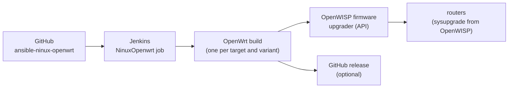

# 5. Firmware and Jenkins

The routers run a **NINUX OpenWrt** firmware built by us: it contains the
network packages (BIRD, ZeroTier, uspot, netconsole…), the openwisp-config
agent already set up to register by itself with our OpenWISP, and the base
settings (users, firewall).

The build is done by the
[ansible-ninux-openwrt](https://github.com/mikysal78/ansible-ninux-openwrt)
repository: an Ansible role and a **Jenkins** pipeline that build all the
variants and upload them to the OpenWISP **firmware upgrader**.



## 1. Jenkins CT

Debian 13 CT on Proxmox with `nesting=1` ([chapter 1](proxmox.md)).

| Resource | Minimum | Recommended |
|---|---|---|
| CPU | 4 cores | 12 cores |
| RAM | 8 GB | 24 GB |
| Disk | 80 GB | 200 GB |

The installation is automatic:

```bash
git clone https://github.com/mikysal78/ansible-ninux-openwrt.git
cd ansible-ninux-openwrt
sudo ./setup/install-jenkins.sh
```

The script installs Java 21, Ansible (pipx), Jenkins LTS, the OpenWrt build
dependencies, the persistent ccache, the tmpfs and the sudo permissions for the
`jenkins` user. The manual procedure, step by step, is in the
[README](https://github.com/mikysal78/ansible-ninux-openwrt#manual-step-by-step-installation).

## 2. Jenkins configuration

1. Open `http://<CT IP>:8080`, enter the initial password
   (`/var/lib/jenkins/secrets/initialAdminPassword`), install the suggested
   plugins and create the administrator.
2. Additional plugins: **Ansible**, **Timestamper**, **Build Timeout**,
   **Workspace Cleanup**.
3. *Manage Jenkins → Tools → Ansible installations*: name `ansible`, path of the
   Ansible executables installed by pipx.
4. **Job**: *New Item* → `NinuxOpenwrt` → **Pipeline**:
    - *Do not allow concurrent builds*, 240 minutes timeout;
    - *Pipeline script from SCM*, Git,
      `https://github.com/mikysal78/ansible-ninux-openwrt.git`, branch
      `*/main`, script `Jenkinsfile`.
5. **Vault password** in `/var/lib/jenkins/.vault_pass` (mode 600, owner
   `jenkins`): it decrypts the secrets in `ninux.yml`.

The job parameters (organization, OpenWrt version, VPN and captive portal
variants, upload to OpenWISP…) are described in the
[README](https://github.com/mikysal78/ansible-ninux-openwrt#5-job-parameters).

!!! warning "Jenkins builds `main`"
    The job takes the code from GitHub: firmware changes must be **pushed**
    before starting the build.

## 3. ninux.yml

The build configuration is in `ninux.yml` (from `ninux.yml.example`):

- OpenWrt version and variants to build (VPN, captive portal);
- for every organization: OpenWISP URL, `management_interface`, **shared
  secret** for automatic registration (from [chapter 3](openwisp.md)), API
  token for the upload;
- the default passwords of `root` and of the `admin` service user
  ([chapter 6](router.md)).

The openwisp-config agent feed (our fork, [chapter 4](moduli.md)) is in
`config/build.yml`.

Secret values are encrypted with ansible-vault, one by one:

```bash
ansible-vault encrypt_string --encrypt-vault-id default 'CHANGEME' --name 'shared_secret'
```

Full examples in the README, section
[Managing secrets with ansible-vault](https://github.com/mikysal78/ansible-ninux-openwrt#managing-secrets-with-ansible-vault).

## 4. Devices and organizations

Every router model has its own file in
`config/organizations/<org>/<device>.config`. For a new model, or a new
organization, follow
[Adding devices and organizations](https://github.com/mikysal78/ansible-ninux-openwrt#adding-devices-and-organizations).

## 5. Firmware upgrader

The build uploads every image to OpenWISP with the firmware upgrader API:

- **one category per variant** (e.g. "Ninux Basilicata - tplink_c2600 -
  Standard VPN-ZeroTier"), so every router always receives its own variant;
  the category name stays within 64 characters;
- the image `type` field must match a model known to OpenWISP. Models OpenWISP
  does not know (e.g. TOTOLINK X5000R, TP-Link C2600, Zyxel NWA50AX Pro) are
  declared in `OPENWISP_CUSTOM_OPENWRT_IMAGES` in the openwisp2 playbook: the
  two lists must stay identical.

After the build, a router upgrade is started from OpenWISP (device page or
mass upgrade of the build) or from the [app](app.md).

!!! danger "x86 border router"
    For x86 the firmware upgrader only knows the `combined-efi` (GPT) image,
    while our border router boots in BIOS mode with MBR. The border router is
    upgraded **by hand** with the `squashfs-combined` image of the build: copy
    it with `scp -O`, test it with `sysupgrade -T`, then `sysupgrade`. Never
    start its upgrade from OpenWISP.

## Checklist

- [ ] The first build ends SUCCESS and the images are in OpenWISP
      (Firmware → Builds).
- [ ] Every device has its own category and the right image.
- [ ] A router upgraded from OpenWISP comes back online with the configuration
      applied.
