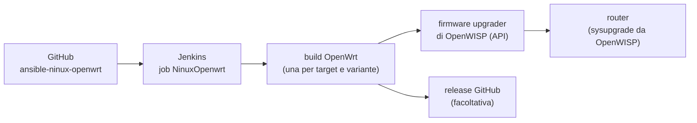

# 5. Firmware e Jenkins

I router usano un firmware **OpenWrt NINUX** compilato da noi: contiene i
pacchetti della rete (BIRD, ZeroTier, uspot, netconsole…), l'agente
openwisp-config già configurato per registrarsi da solo al nostro OpenWISP e
le impostazioni di base (utenti, firewall).

La compilazione la fa il repository
[ansible-ninux-openwrt](https://github.com/mikysal78/ansible-ninux-openwrt):
un ruolo Ansible e una pipeline **Jenkins** che compilano tutte le varianti e
le caricano nel **firmware upgrader** di OpenWISP.



## 1. CT di Jenkins

CT Debian 13 su Proxmox con `nesting=1` ([capitolo 1](proxmox.md)).

| Risorsa | Minimo | Consigliato |
|---|---|---|
| CPU | 4 core | 12 core |
| RAM | 8 GB | 24 GB |
| Disco | 80 GB | 200 GB |

L'installazione è automatica:

```bash
git clone https://github.com/mikysal78/ansible-ninux-openwrt.git
cd ansible-ninux-openwrt
sudo ./setup/install-jenkins.sh
```

Lo script installa Java 21, Ansible (pipx), Jenkins LTS, le dipendenze della
build di OpenWrt, la ccache persistente, il tmpfs e i permessi sudo per
l'utente `jenkins`. La procedura manuale, passo per passo, è nel
[README](https://github.com/mikysal78/ansible-ninux-openwrt/blob/main/README.it.md#installazione-manuale-passo-per-passo).

## 2. Configurazione di Jenkins

1. Apri `http://<IP del CT>:8080`, inserisci la password iniziale
   (`/var/lib/jenkins/secrets/initialAdminPassword`), installa i plugin
   suggeriti e crea l'amministratore.
2. Plugin aggiuntivi: **Ansible**, **Timestamper**, **Build Timeout**,
   **Workspace Cleanup**.
3. *Manage Jenkins → Tools → Ansible installations*: nome `ansible`, percorso
   degli eseguibili di Ansible installati da pipx.
4. **Job**: *New Item* → `NinuxOpenwrt` → **Pipeline**:
    - *Do not allow concurrent builds*, timeout 240 minuti;
    - *Pipeline script from SCM*, Git,
      `https://github.com/mikysal78/ansible-ninux-openwrt.git`, branch
      `*/main`, script `Jenkinsfile`.
5. **Password del vault** in `/var/lib/jenkins/.vault_pass` (permessi 600,
   proprietario `jenkins`): serve a decifrare i secret in `ninux.yml`.

I parametri del job (organizzazione, versione di OpenWrt, varianti VPN e
captive portal, upload su OpenWISP…) sono descritti nel
[README](https://github.com/mikysal78/ansible-ninux-openwrt/blob/main/README.it.md#5-parametri-del-job).

!!! warning "Jenkins compila `main`"
    Il job prende il codice da GitHub: le modifiche al firmware vanno
    **pushate** prima di lanciare la build.

## 3. ninux.yml

Tutta la configurazione della build sta in `ninux.yml` (da `ninux.yml.example`):

- versione di OpenWrt e varianti da compilare (VPN, captive portal);
- per ogni organizzazione: URL di OpenWISP, `management_interface`,
  **shared secret** della registrazione automatica (dal
  [capitolo 3](openwisp.md)), token API per il caricamento;
- le password di default di `root` e dell'utente di servizio `admin`
  ([capitolo 6](router.md));
- il feed dell'agente openwisp-config (il nostro fork, in `config/build.yml`, [capitolo 4](moduli.md)).

I valori segreti si cifrano con ansible-vault, uno per uno:

```bash
ansible-vault encrypt_string --encrypt-vault-id default 'CHANGEME' --name 'shared_secret'
```

Esempi completi nel README, sezione
[Gestione segreti con ansible-vault](https://github.com/mikysal78/ansible-ninux-openwrt/blob/main/README.it.md#gestione-segreti-con-ansible-vault).

## 4. Device e organizzazioni

Ogni modello di router ha il suo file in
`config/organizations/<org>/<device>.config`. Per un modello nuovo, o per una
nuova organizzazione, segui
[Aggiungere device e organizzazioni](https://github.com/mikysal78/ansible-ninux-openwrt/blob/main/README.it.md#aggiungere-device-e-organizzazioni).

## 5. Firmware upgrader

La build carica ogni immagine in OpenWISP con l'API del firmware upgrader:

- **una categoria per variante** (es. «Ninux Basilicata - tplink_c2600 -
  Standard VPN-ZeroTier»), così ogni router riceve sempre la sua variante;
  il nome della categoria resta entro i 64 caratteri;
- il campo `type` dell'immagine deve corrispondere a un modello noto a
  OpenWISP. I modelli che OpenWISP non conosce (es. TOTOLINK X5000R, TP-Link
  C2600, Zyxel NWA50AX Pro) sono dichiarati in `OPENWISP_CUSTOM_OPENWRT_IMAGES`
  nel playbook openwisp2: le due liste devono restare uguali.

Dopo la build, l'aggiornamento di un router si avvia da OpenWISP (pagina del
device o aggiornamento di massa della build) oppure dall'[app](app.md).

!!! danger "Router x86 di confine"
    Per x86 il firmware upgrader conosce solo l'immagine `combined-efi` (GPT),
    mentre il nostro router di confine si avvia in BIOS con MBR. Il confine si
    aggiorna **a mano** con l'immagine `squashfs-combined` della build:
    copia con `scp -O`, prova con `sysupgrade -T`, poi `sysupgrade`. Non
    avviare mai il suo aggiornamento da OpenWISP.

## Controllo

- [ ] La prima build finisce SUCCESS e le immagini sono in OpenWISP
      (Firmware → Builds).
- [ ] Ogni device ha la sua categoria e l'immagine giusta.
- [ ] Un router aggiornato da OpenWISP torna online con la configurazione
      applicata.
