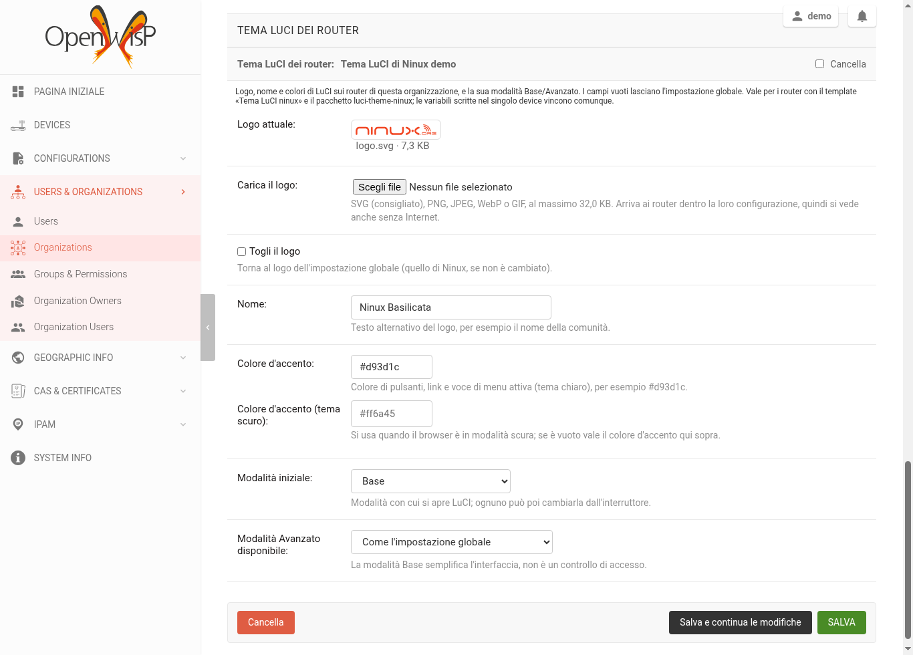

# 4. OpenWISP modules

Four modules of ours complete OpenWISP. The first three are small Django apps:
two extend the device page, one the organization page; the fourth is the agent
that runs on the routers. The openwisp2 playbook already installs the three
apps: this chapter explains what they do and what to check.

## openwisp-netconsole

[Repository](https://github.com/mikysal78/openwisp-netconsole) ·
**Netconsole** tab on the device page.

Routers send kernel messages to the server with **netconsole** (UDP 6666), in
real time, even in the last moments before a hang or a kernel panic, when
syslog no longer makes it. rsyslog stores them in
`/opt/router-logs/netconsole-<device name>/`, and the tab shows them refreshed
every few seconds, with the rotated files available for download.

- **Server side**: Play 5 of openwisp2 (rsyslog, `router-logs` group with
  read-only access for OpenWISP, rotation script).
- **Router side**: **Netconsole** template (target in configfs, check every 5
  minutes, device name as *userdata*). It needs the NINUX firmware with
  `kmod-netconsole` built with `NETCONSOLE_DYNAMIC`.
- **Log rotation**: set from OpenWISP, *Monitoring → Router log rotation* page
  (superusers only). Defaults: daily or over 50 MB, 15 days, at most 30 files.
- **API** for the app: `GET /api/v1/netconsole/device/<uuid>/logs/` (since 0.2).

## openwisp-luci

[Repository](https://github.com/mikysal78/openwisp-luci) ·
**LuCI ↗** button on the device page.

It opens the router web interface in a new tab through the server: the router
needs to be reachable only from the server, not from the browser.

- One host per router: `https://<uuid>.luci.ninux-nnxx.it`, so cookies and
  sessions of one router never reach the others. It needs the `*.luci` DNS and
  the `luci.ninux-nnxx.it` certificate ([chapter 2](dns.md)); Play 6 stops if
  the certificate is missing.
- Single-use link valid for 60 seconds, then a `__Host-` cookie bound to user,
  device and password; nginx asks OpenWISP on every request whether the user
  is still allowed.
- **Automatic login** for superusers: OpenWISP creates over SSH a LuCI session
  for the `admin` service user of the router. No password on the server.
  Everybody else, and whoever wants to log in as `root`, uses the LuCI login.
- Routers managed on the `wan`: the `Allow-LuCI-OpenWISP` rule opens port 443
  only from the server.
- **API** for the app: `POST /api/v1/luci/device/<uuid>/link/` (since 0.3; use
  at least 0.3.1 to open it from the app).

!!! warning "OpenWISP session cookie"
    The `*.luci` subdomains belong to the same domain as OpenWISP: the OpenWISP
    session cookie must be called `__Host-sessionid`, which subdomains cannot
    overwrite. The playbook sets it.

## openwisp-luci-theme

[Repository](https://github.com/mikysal78/openwisp-luci-theme) ·
**LuCI theme of the routers** box on the organization page.

Each organization picks logo, name, colours and Basic/Advanced mode of the
[LuCI theme](openwisp.md#3-first-login) on its routers.



- **Uploaded logo**: SVG (best), PNG, JPEG, WebP or GIF up to 32 KB. It reaches
  the router inside its configuration, as a `data:` URI: it shows even without
  Internet. SVGs with scripts or external references are rejected.
- **Empty fields**: keep the global value of the playbook (`ninux_luci_*`).
  Variables set on a single device still win.
- **Router update**: saving the box makes OpenWISP recompute the configuration
  of the organization's devices, which download it at their next check. The
  **Tema LuCI ninux** template must be assigned to the routers.
- **Permissions**: superusers and the *Administrator* group edit, *Operator*
  views.

## openwisp-config (fork)

[Repository](https://github.com/mikysal78/openwisp-config) · the agent running
on the routers.

It is the fork of the official agent with the fixes to the `SIGUSR1/USR2`
signals: without them the agent could die in the first loop after boot or
while applying a configuration, leaving the router stuck on "config
modified". The problem is reported upstream in
[openwisp-config#283](https://github.com/openwisp/openwisp-config/issues/283).

The NINUX firmware takes it from the `fix/sigusr-handlers-startup` branch of
the fork, with the feed in `config/build.yml` of ansible-ninux-openwrt:

```
src-git openwisp_config https://github.com/mikysal78/openwisp-config.git;fix/sigusr-handlers-startup
```

When the fix lands upstream, we will go back to the official package.

## Checklist

- [ ] The device page has the **Netconsole** tab and the **LuCI ↗** button.
- [ ] Netconsole shows recent lines for a router with the Netconsole template.
- [ ] LuCI opens (as a superuser, already logged in as `admin`).
- [ ] `curl -X OPTIONS https://openwisp.ninux-nnxx.it/api/v1/luci/device/00000000-0000-0000-0000-000000000000/link/`
- [ ] On the organization page there is the **LuCI theme of the routers** box.
      answers 405 (API present), not 404.
