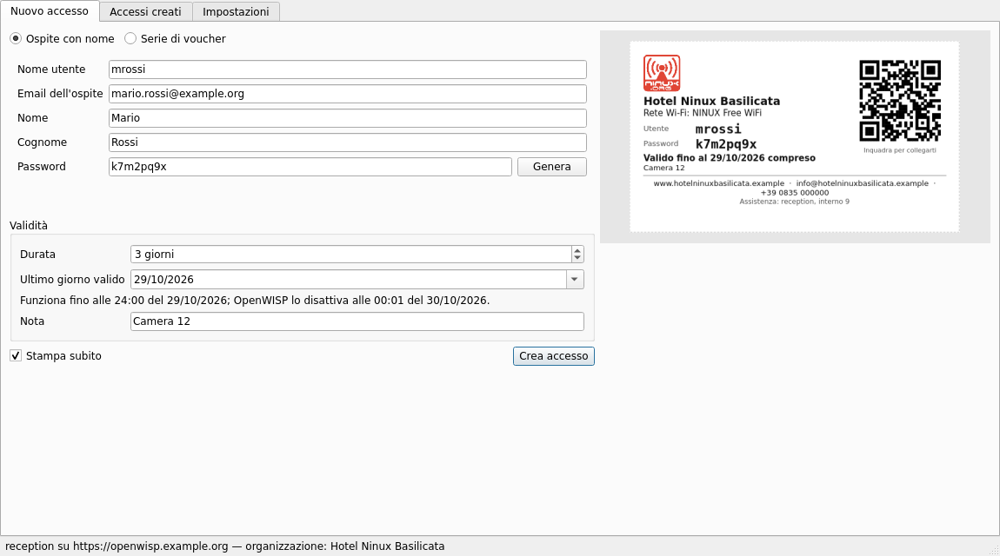
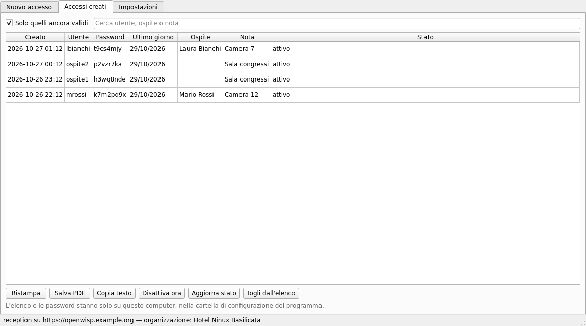
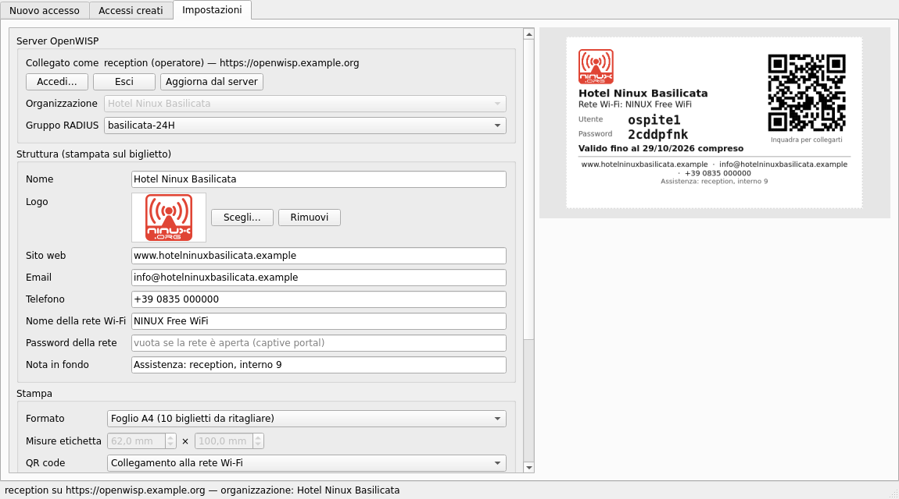
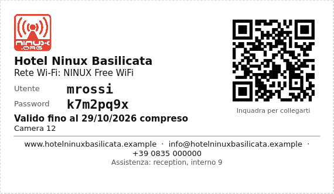
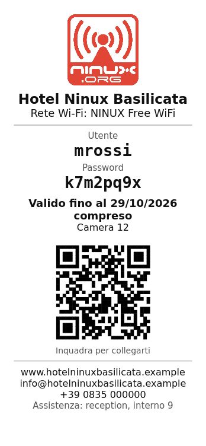

# 8. Time-limited Wi-Fi access

[openwisp-voucher](https://github.com/mikysal78/openwisp-voucher) is a desktop
program (Linux and Windows) that creates **time-limited Wi-Fi accounts** for
the captive portal and prints them as **tickets or labels**, like hotels do:
"Mario has access for 3 days, then the account switches off by itself". It
uses the OpenWISP REST API: nothing to install on the server.

## What it does

- **named guest** (username, email, generated password) or **voucher series**
  (`guest1`, `guest2`, …) with passwords generated by the server;
- **duration in days**: the printed date is the last valid day, OpenWISP
  disables the account at 00:01 the next day; it can also be disabled at once;
- prints on **A4 sheets** (10 tickets), 58/80 mm **receipts** or **labels** of
  any size, with logo, website, email, phone, network name and QR code; or PDF
  or text to copy;
- list of the accounts created, with reprint and status read from the server;
- the **superuser** chooses the organization, an **operator** sees only their
  own.

The screenshots use made-up data ("Hotel Ninux Basilicata"); the interface is also
available in English.

| Ticket from the A4 sheet | 58 mm receipt |
|---|---|
|  | { width="220" } |

## Installation

Download the executable from the
[releases](https://github.com/mikysal78/openwisp-voucher/releases):
`openwisp-voucher-<version>-windows.exe` for Windows,
`openwisp-voucher-<version>-linux-x86_64.tar.gz` for Linux. Nothing to
install: just run it. On Windows the executable is not signed yet and
SmartScreen asks for confirmation ("More info" → "Run anyway"); the
application for free signing by the SignPath Foundation is pending.

In **Settings**: "Log in…" with the server (`openwisp.ninux-nnxx.it`) and your
user, then organization, RADIUS group, logo and venue details. The password is
only used to obtain the token, which goes into the system keyring.

## Server side

| What | Where |
|---|---|
| openwisp-radius batch API and the `deactivate_expired_users` task | already in the openwisp2 playbook |
| RADIUS group for guests | admin → RADIUS → Groups; for Basilicata `basilicata-24H` (24 hours and 3 GB per day) |
| Login page that accepts the **username** | `login_form.input_fields.username.type: "text"` in the organization YAML (see [chapter 3](openwisp.md)) |
| Operator users (reception) | staff, organization managers, permissions listed in the [README](https://github.com/mikysal78/openwisp-voucher#operator-accounts) |

!!! warning "Guest email"
    OpenWISP wants a different email for each user. With an email already in
    use openwisp-radius 1.3 answers with a generic 500 error: the program
    checks it first and says so clearly.

## Releases

GitHub Actions builds the releases when a `v*` tag is pushed: tests,
Windows and Linux executables with PyInstaller, SHA256 and build provenance
attestation. The procedure is in the program's README, section
[Development](https://github.com/mikysal78/openwisp-voucher#development).
